# HeatSafe — App (Mobile Development & IoT)

> Global Solution 2026.2 · CitizenTech · Engenharia de Software 3º ano (3ESPG) · FIAP

## Ficha da CitizenTech

| Campo | Resposta |
|---|---|
| **Nome** | HeatSafe |
| **Cidade e bairro** | São Paulo, Itaim Paulista (zona leste): casas térreas com telha de fibrocimento |
| **Cidadão beneficiado** | Idosos que moram ou passam o dia sozinhos em casas quentes. Também ajuda familiares e agentes comunitários de saúde da UBS |
| **Problema, em uma frase** | Nos dias de calor extremo, idosos que passam o dia sozinhos em casas quentes podem passar mal sem perceber o risco, e ninguém fica sabendo a tempo. |
| **Como funciona** | Um dispositivo com ESP32 dentro da casa mede o índice de calor e detecta movimento. O idoso registra a água que bebe. Se a casa fica perigosa e o idoso fica parado ou sem beber água, a família recebe um alerta; sem resposta em 20 min, o caso vai para a lista de visitas da UBS. Um modelo de ML com dados do INMET prevê os dias perigosos na véspera. |
| **O que o app faz** | É a porta de entrada do HeatSafe: o idoso vê o calor da casa e toca em "Estou bem" e "Bebi água"; a família acompanha a casa e confirma os alertas; o agente de saúde vê a lista de visitas por prioridade. |
| **Indicador de impacto** | Tempo entre o alerta e a confirmação da família · % de alertas confirmados em até 30 min · copos de água registrados por dia |
| **ODS conectados** | 3 (Saúde e bem-estar) · 10 (Redução das desigualdades) · 11 (Cidades sustentáveis) · 13 (Ação contra a mudança do clima) |

## Integrantes

| Nome | RM |
|---|---|
| Felipe Braunstein e Silva | RM554483 |
| Felipe do Nascimento Fernandes | RM554598 |
| Henrique Ignacio Bartalo | RM555274 |
| Gustavo Henrique Martins | RM556956 |

## Vídeo

▶️ **[Assistir no YouTube](https://youtube.com/shorts/gyjgLF9EyHA)** (1min31): app rodando no iPhone pelo Expo Go, com a jornada completa nos três modos e os dados sendo salvos e recuperados do SQLite.

---

## Como rodar

Pré-requisitos: [Node.js](https://nodejs.org) 20 ou mais recente e o app **Expo Go** no celular ([Android](https://play.google.com/store/apps/details?id=host.exp.exponent) / [iOS](https://apps.apple.com/app/expo-go/id982107779)).

```bash
git clone <link-do-repositorio>
cd heatsafe-mobile
npm install
npx expo start
```

Escaneie o QR Code com a câmera (iOS) ou com o Expo Go (Android). O celular e o computador precisam estar na mesma rede Wi-Fi; se não estiverem, use `npx expo start --tunnel`.

Não é preciso configurar nenhuma chave ou arquivo `.env`: a API pública usada não exige chave e o banco é local. O `.env` já está no `.gitignore` caso o projeto passe a usar uma API com chave.

Outros comandos:

```bash
npm run typecheck   # checagem de tipos (tsc --noEmit)
npm run lint        # ESLint (expo lint)
```

## Telas e jornada

O app tem **3 modos** (escolhidos na aba Perfil), porque cada pessoa do ecossistema usa o HeatSafe de um jeito:

| Tela | O que mostra |
|---|---|
| **Início** | **Idoso:** índice de calor dentro da casa (cor + ícone + texto), botões grandes **"Estou bem"** e **"Bebi água"** (salvos no banco) e o clima de São Paulo. **Família:** situação da casa (calor, último movimento, última água) e aviso quando há risco. **Agente:** resumo das casas em risco. |
| **Alertas** | Lista de alertas da casa, com nível de risco e se já foi confirmado |
| **Detalhe do alerta** | Motivo, o que fazer e o botão **"Confirmar que falei com ela"** com observação (salvo no banco) |
| **Histórico** | Tudo o que foi registrado no celular: "Estou bem", copos de água e confirmações |
| **Visitas** (só agente) | Lista de visitas ordenada pela pontuação de risco |
| **Perfil** | Modo de uso, dados (fictícios) e a simulação para demonstração (cenário da casa e falha do servidor), salvos no banco |

**Jornada principal (idoso → família):** no Início, a Dona Maria vê que a casa está em *Perigo* e toca em "Bebi água" → o registro aparece no Histórico → no modo Família, a Ana abre o alerta, confirma que ligou e a confirmação fica salva e aparece de novo ao reabrir o alerta.

### Prints

Capturas feitas no iPhone, com o app rodando no Expo Go.

**Modo idoso**

| Início | Início (rolando) | Histórico (dados do SQLite) |
|---|---|---|
| 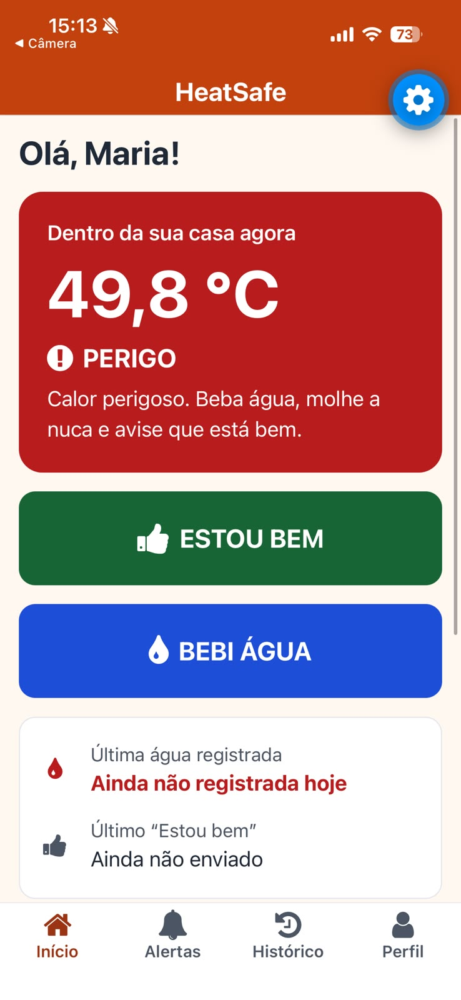 | 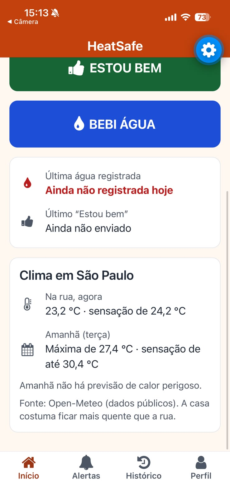 | 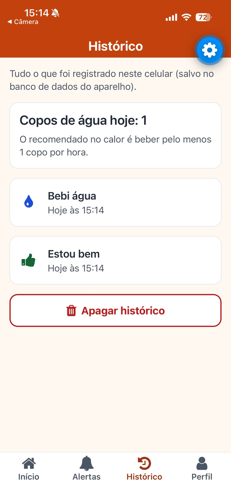 |

**Modo família**

| Início com aviso de risco | Situação da casa | Alertas |
|---|---|---|
| 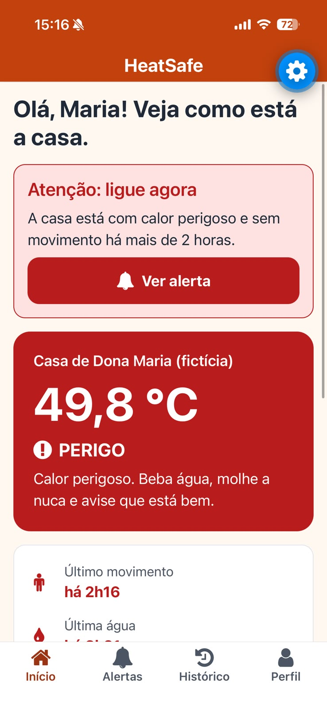 | 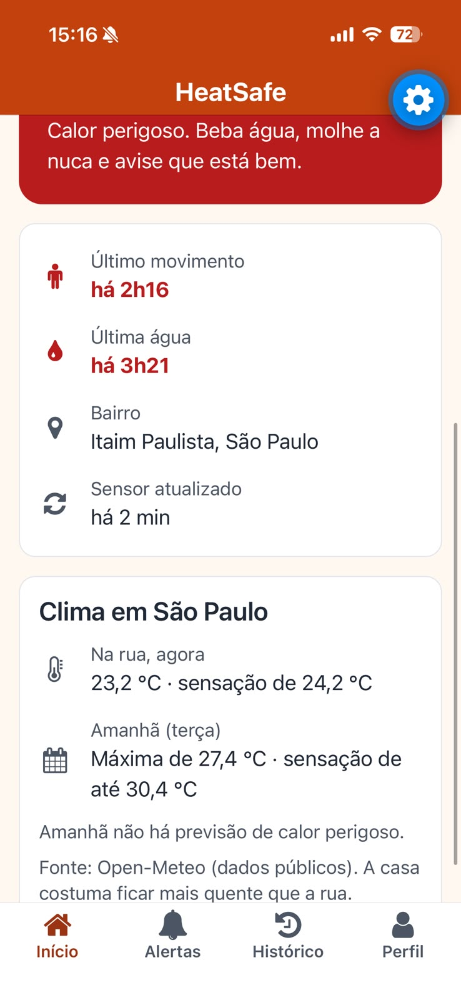 | 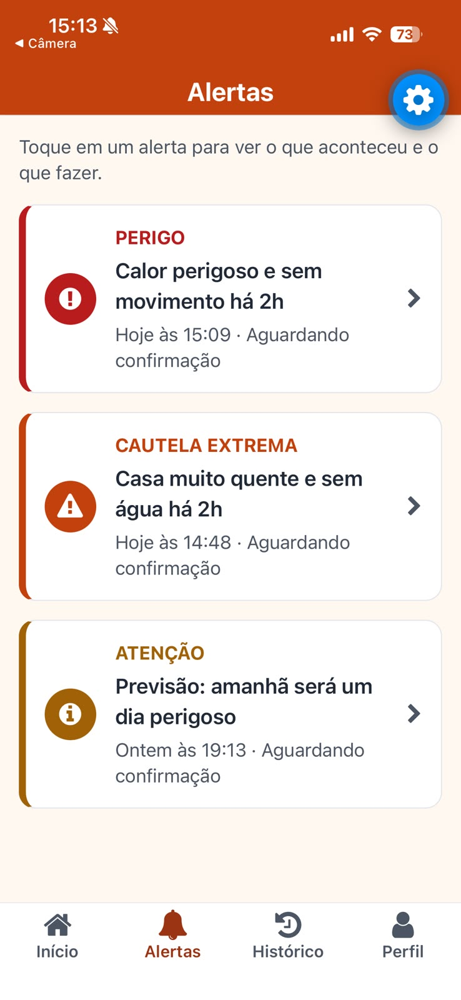 |

| Detalhe do alerta | Detalhe do alerta de previsão |
|---|---|
| 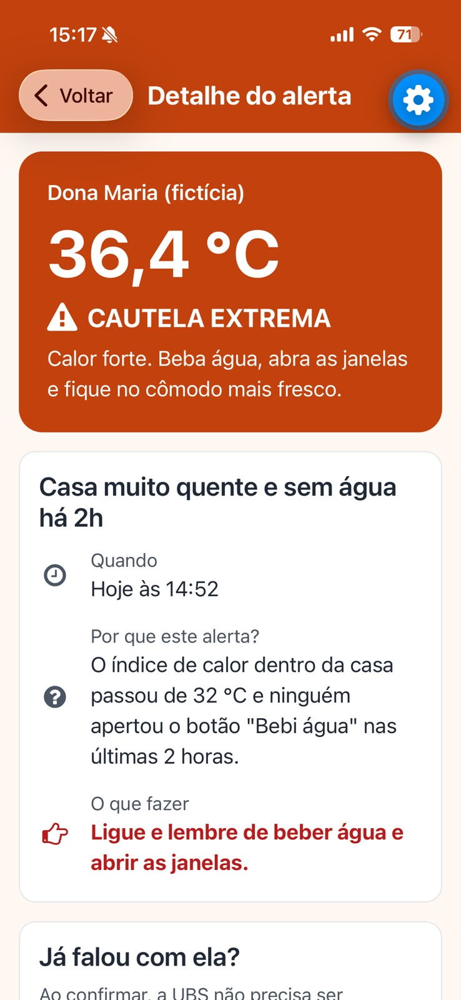 | 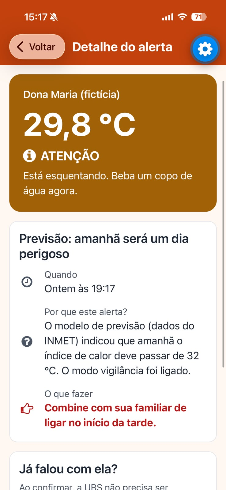 |

**Modo agente de saúde (UBS)**

| Início | Visitas prioritárias |
|---|---|
| 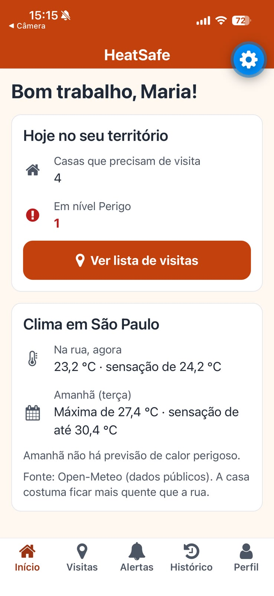 | 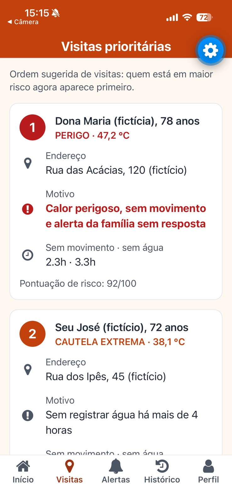 |

**Perfil (salvo no SQLite)**

| Modo de uso | Dados e simulação |
|---|---|
| 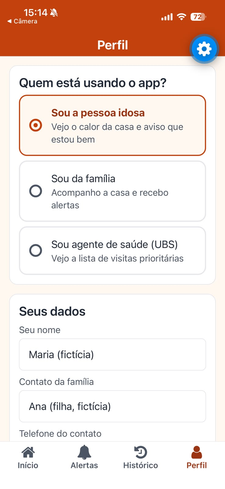 | 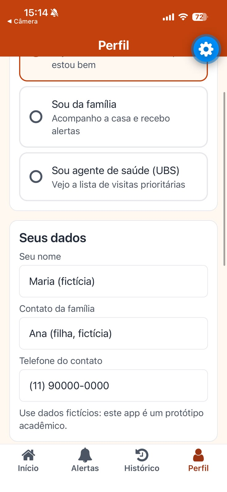 |

## De onde vêm os dados

| Dado | Fonte | Tipo |
|---|---|---|
| Clima de São Paulo agora e previsão de amanhã | **[Open-Meteo](https://open-meteo.com)**: API pública e gratuita, sem chave (`src/services/climaService.ts`) | Real, público |
| Leituras do sensor da casa, alertas e lista de visitas | **Mock** que simula o backend do HeatSafe (API C# + dispositivo ESP32), com atraso de rede e falha opcional (`src/mocks/dados.ts` e `src/services/heatsafeApi.ts`) | Simulado |
| Perfil, "Estou bem", água e confirmações | Digitados no app e salvos no **SQLite** do aparelho | Local |

**Nenhum dado pessoal real é usado.** Todas as pessoas e endereços do mock são fictícios e estão marcados como "(fictícia)". Para trocar o mock pela API C# real, basta mudar o corpo das funções em `src/services/heatsafeApi.ts` para chamar `getJson()`.

O índice de calor é calculado com a fórmula da NOAA (`src/services/indiceCalor.ts`), a mesma do dispositivo ESP32 e da preparação dos dados do INMET usados no modelo de ML.

## Banco de dados: SQLite (expo-sqlite)

**Por que SQLite:**
- **Funciona sem internet.** Muitas casas da periferia não têm Wi-Fi estável, e o idoso precisa conseguir registrar "Bebi água" mesmo offline.
- **Gratuito, sem conta, sem chave** para vazar no repositório.
- **Já vem no Expo Go**, então qualquer pessoa roda o app sem configurar nada.
- Os dados de saúde e de rotina ficam no aparelho, o que reduz a exposição (LGPD).

**Tabelas** (`src/database/migrations.ts`, versionadas com `PRAGMA user_version`):

| Tabela | Campos | Uso |
|---|---|---|
| `perfil` | nome, modo, contato_nome, contato_telefone, cenario, simular_falha | Preferências (uma linha só) |
| `registros` | id, tipo (`ESTOU_BEM`, `AGUA`, `CONFIRMACAO_ALERTA`), data_hora, observacao, alerta_id | Histórico do cidadão |

O acesso ao banco fica numa camada própria (`src/database/*Repository.ts`). As telas nunca escrevem SQL diretamente.

## Estados de carregamento, erro e vazio

Toda tela que busca dados usa o hook `useRequisicao` e o componente `EstadoView`:
- **Carregando:** indicador com mensagem ("Lendo o sensor da casa...").
- **Erro:** mensagem em linguagem simples e botão "Tentar de novo". Para demonstrar, ative **Perfil → Simular falha do servidor**.
- **Vazio:** mensagem amigável. Para demonstrar, escolha **Perfil → Dia tranquilo** (sem alertas e sem visitas) ou abra o Histórico antes de registrar algo.

Todas as telas também têm "puxar para atualizar".

## Acessibilidade e usabilidade

- **Contraste:** todas as combinações de cor do tema passam no WCAG AA (≥ 4,5:1).
- **Nível de risco por cor, ícone e texto**, nunca só por cor (pensando em daltonismo).
- **Fontes grandes** (mínimo de 16 pt; valor do índice em 56 pt) que respeitam o tamanho de fonte escolhido no celular.
- **Botões grandes** (altura mínima de 56 a 80 pt) com ícone e texto.
- **Leitor de tela:** `accessibilityLabel`, `accessibilityRole`, `accessibilityHint` e `accessibilityState` nos componentes interativos; cartões lidos como uma frase completa; avisos anunciados com `accessibilityLiveRegion`.
- **Linguagem simples:** "Estou bem", "Bebi água", "Tentar de novo", sem termos técnicos.

## Estrutura do projeto

```
src/
├── app/                    # Telas (Expo Router)
│   ├── _layout.tsx         # SQLiteProvider + PerfilProvider + Stack
│   ├── (tabs)/             # Início, Visitas, Alertas, Histórico, Perfil
│   └── alerta/[id].tsx     # Detalhe do alerta
├── components/             # Componentes reutilizáveis (BotaoGrande, NivelCard, EstadoView...)
├── contexts/               # PerfilContext (perfil salvo no SQLite)
├── database/               # Migrações e repositórios (camada de banco)
├── hooks/                  # useRequisicao, useRegistros
├── mocks/                  # Dados simulados do backend
├── services/               # Camada de serviços: Open-Meteo, API HeatSafe (mock), índice de calor
├── theme/                  # Cores, fontes, espaçamentos (tema centralizado)
├── types/                  # Tipos TypeScript
└── utils/                  # Formatação de datas e números
prompts.md                  # Registro do uso de IA (regra da GS)
```

## Uso de IA

Seguindo a regra da GS (*"IA como copiloto"*), os prompts usados, o que foi aproveitado, o que revisamos e como explicar cada parte do código estão em [`prompts.md`](prompts.md).

## Tecnologias

Expo SDK 58 · React Native · TypeScript · Expo Router (abas + pilha) · expo-sqlite · Open-Meteo API · @expo/vector-icons. Tudo gratuito.
